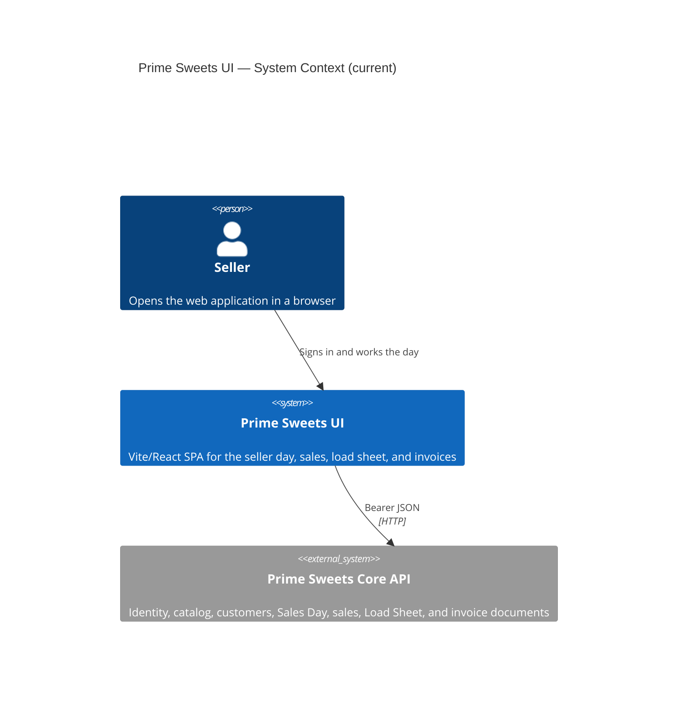

# C4 Level 1 — System Context (current)

**Sources:** `src/`, `package.json`, `.env.example`.

The UI is the seller SPA. Routes cover login, the current Sales Day, customers, day sales, a sale, the load sheet, the invoice list, and invoice preview. Signed-out visitors go to `/login`. Printing uses the browser print dialog.

## Diagram

## People

| Person | Relationship in code |
|---|---|
| Seller | Signs in, works today's Sales Day, and prints invoices from the browser. |

## External systems

| System | Role in code |
|---|---|
| Prime Sweets Core API | Named by `VITE_API_BASE_URL` (default `http://localhost:4000`). Every business screen calls it with the bearer token. |
| Alegra | Not a UI dependency. Product sync stays in the API. |
| PostgreSQL | Not a UI dependency. |
| Windows printer | Used only through the browser print dialog. The UI does not pick a device or speak a printer protocol. |
