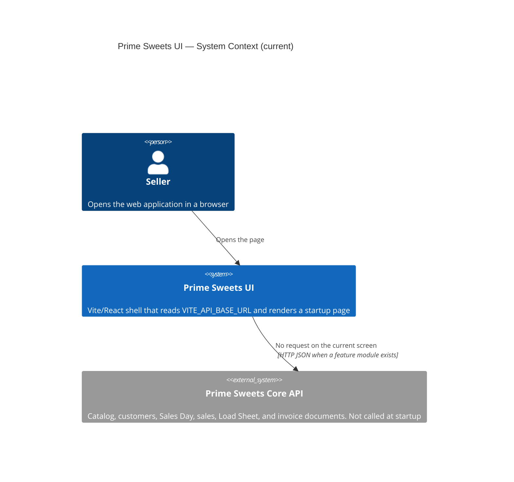

# C4 Level 1 — System Context (current)

**Sources:** `src/`, `package.json`, `.env.example`.

The UI is a browser shell. It shows the configured API base URL. It does not load brands, customers, sales days, sales, a Load Sheet, or an invoice. It does not open a print dialog.

## Diagram

## People

| Person | Relationship in code |
|---|---|
| Seller | Opens the SPA. There is no sign-in screen and no role switch. |

## External systems

| System | Role in code |
|---|---|
| Prime Sweets Core API | Named by `VITE_API_BASE_URL` (default `http://localhost:3000`). The shell constructs an HTTP client and does not issue a request. |
| Alegra | Not a UI dependency. Product sync stays in the API. |
| PostgreSQL | Not a UI dependency. |
| Windows printer | Not used. Printing is specified in the PDR and is not implemented. |
