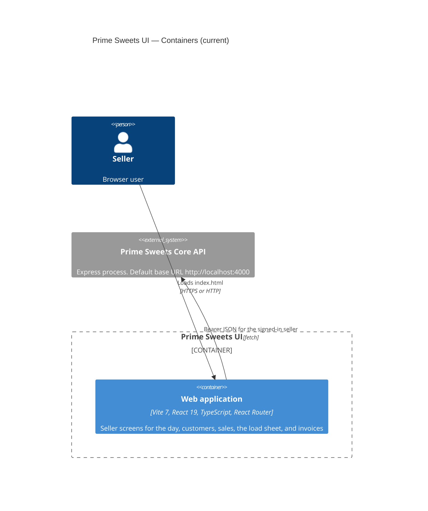

# C4 Level 2 — Containers (current)

**Sources:** `package.json`, `vite.config.ts`, `index.html`, `src/main.tsx`.

One static SPA. Vite serves it in development and builds it for production. There is no worker, no local database, and no print process.

## Diagram

## Web application

`npm run dev` starts Vite on port `3000`. `npm run build` runs `tsc -b` and `vite build`.

`src/main.tsx` mounts React on `#root`, builds the composition container, and renders `App`.

Stack: TypeScript ESM, React 19, Vite 7, ESLint 9 flat config, Prettier 3.

## Core API

The composition root builds the HTTP client and the use cases. The bearer token comes from the session in `sessionStorage`.

## Deployment notes (verified)

| Topic | Current behavior |
|---|---|
| Deployable | Static files from `dist/` after `npm run build`. |
| Runtime data | Session in `sessionStorage`. Language in `localStorage`. No draft sale and no printed flag. |
| Print | Browser print dialog for selected invoice documents. |
| Layout | Narrow by default. At `min-width: 64rem` the shell places navigation beside the page. Lists stay one table. |
