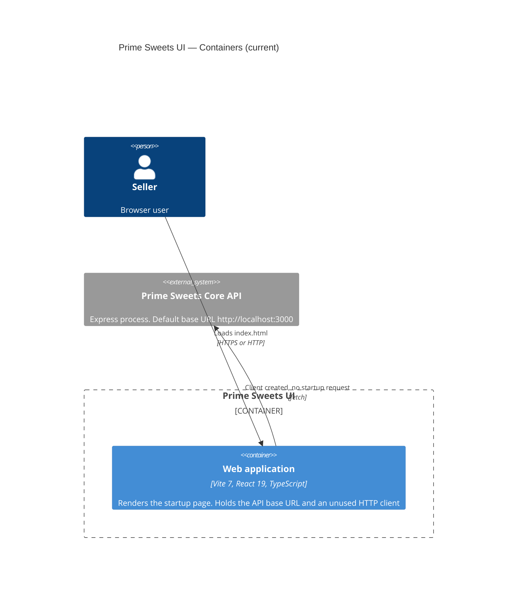

# C4 Level 2 — Containers (current)

**Sources:** `package.json`, `vite.config.ts`, `index.html`, `src/main.tsx`.

One static SPA. Vite serves it in development and builds it for production. There is no worker, no local database, and no print process.

## Diagram

## Web application

`npm run dev` starts Vite on port `5173`. `npm run build` runs `tsc -b` and `vite build`.

`src/main.tsx` mounts React on `#root`, builds the composition container, and renders `App`.

Stack: TypeScript ESM, React 19, Vite 7, ESLint 9 flat config, Prettier 3.

## Core API

Configured only. Feature calls are not wired. Authentication headers are not sent because the shell has no session.

## Deployment notes (verified)

| Topic | Current behavior |
|---|---|
| Deployable | Static files from `dist/` after `npm run build`. |
| Runtime data | None stored in the browser. |
| Print | None. |
| Layout | `src/app/styles.css` centers one column (`max-width: 40rem`). There are no media queries. The Version 1 narrow/wide rules are in the SPEC and are not implemented. |
