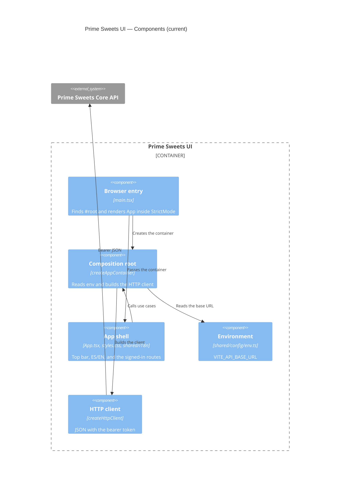

# C4 Level 3 — Components (current)

**Sources:** `src/app/`, `src/shared/`, `src/modules/`.

The SPA has a composition root, a shared HTTP client, and one hexagonal module per seller area: identity, catalog, customers, sales day, sales, and fulfillment output.

## Diagram



## Folder map

```text
src/
  main.tsx
  app/
    App.tsx
    composition.ts
    styles.css
  shared/
    config/env.ts
    infrastructure/http/httpClient.ts
  modules/                    empty
```

Routes: `/sales-day`, `/customers`, `/sales`, `/load-sheets`, `/invoices`. `/` redirects to `/sales-day`. There is still no module for catalog, customers, sales day, sales, or fulfillment output.
