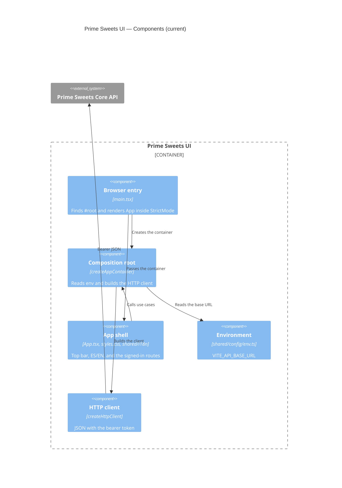

# C4 Level 3 — Components (current)

**Sources:** `src/app/`, `src/shared/`, `src/modules/`.

The SPA has a composition root, a shared HTTP client, and one hexagonal module per seller area: identity, catalog, customers, sales, and fulfillment output. There is no sales-day module. `/sales-day` and `/day-sales` redirect to `/`.

## Diagram



## Folder map

```text
src/
  main.tsx
  app/
    App.tsx
    composition.ts
    styles.css
  shared/
    config/env.ts
    infrastructure/http/httpClient.ts
  modules/
    identity/                  login and session
    catalog/                   product search, product admin, product create
    customers/                 customer create and sale customer search
    sales/                     week home, sale lines, delivery-day list
    fulfillment-output/        load sheet and invoice preview
    purchasing/                suppliers and purchase orders
```

Routes: `/login`, `/`, `/products`, `/products/new`, `/customers`, `/sales`, `/delivery-sales`, `/load-sheets`, `/invoices/:saleId`, `/purchasing`, `/purchasing/:supplierId`. `/` is the week home. `/purchasing/:supplierId?order=` edits the latest order.
