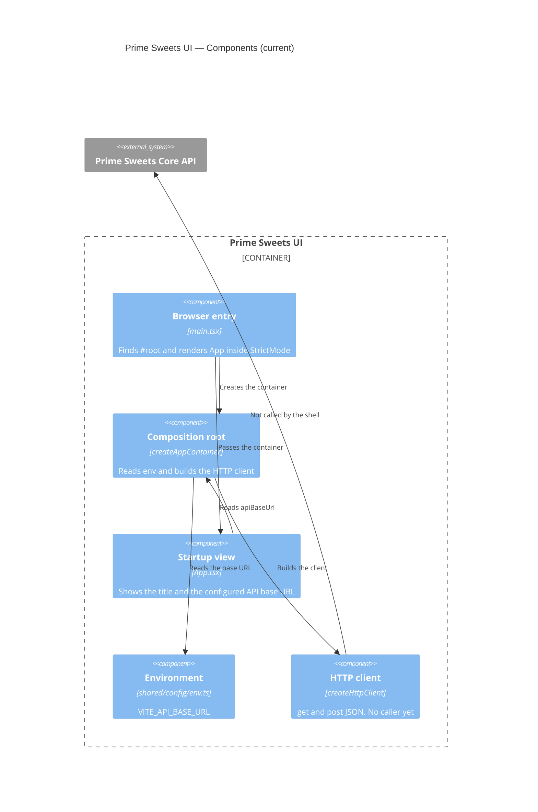

# C4 Level 3 — Components (current)

**Sources:** `src/app/`, `src/shared/`, `src/modules/`.

The SPA has a composition root and a shared HTTP helper. `src/modules/` has no feature code.

## Diagram



## Folder map

```text
src/
  main.tsx
  app/
    App.tsx
    composition.ts
    styles.css
  shared/
    config/env.ts
    infrastructure/http/httpClient.ts
  modules/                    empty
```

There is no router and no module for catalog, customers, sales day, sales, or fulfillment output.
