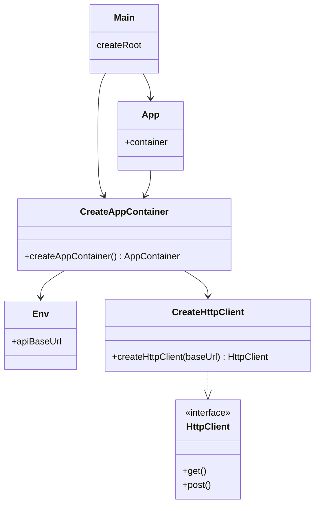
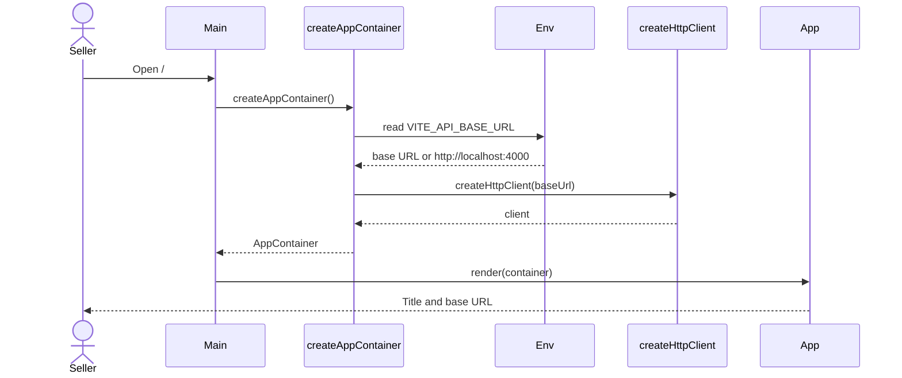

# C4 Level 4 — Code (current)

**Verified flow:** boot the SPA, restore the session, and open the Sales Day when the seller is signed in.

**Sources:** `src/main.tsx`, `src/app/composition.ts`, `src/app/App.tsx`, `src/shared/config/env.ts`, `src/shared/infrastructure/http/httpClient.ts`.

Sale capture, the Load Sheet, and invoice print are use cases behind this boot path. Their screens are in [flows](../flows/README.md).

## Dependencies

## Sequence

No `fetch` runs in this startup sequence. `HttpClient.get` and `HttpClient.post` throw when the response is not OK and otherwise return the JSON body. Login, the current Sales Day, and product search map that body in their infrastructure adapters. The four lists do not call the API.
